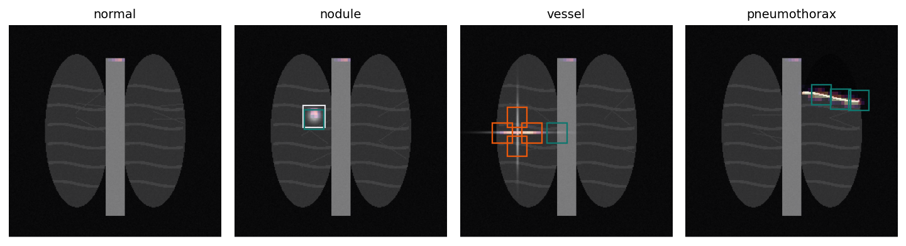

# DICOM stream triage

A synthetic chest-radiograph benchmark for three pipeline questions: how fast an uncompressed DICOM frame becomes a windowed tensor, whether a spatial-entropy cap removes false nodule boxes that a confidence cut keeps, and whether a priority queue opens pneumothorax studies sooner than first-in, first-out.

This is not a clinical device, not a PACS, and not a detector trained on hospital studies. The numbers below are one CPU run at seed 0. [BENCHMARK_RESULTS.md](BENCHMARK_RESULTS.md) is that run. [docs/PRD.md](docs/PRD.md) is the requirement the run is scored against. [docs/TECHNICAL_REPORT.md](docs/TECHNICAL_REPORT.md) is what the code does. [docs/PAPER.md](docs/PAPER.md) is the same run written as a technical note, including the imaging background that the measurements do not by themselves establish.

## Demo

```powershell
pip install -r requirements.txt
python -m dicom_triage.runner --synthetic
streamlit run app.py
```

The board is local only, at [http://127.0.0.1:8504](http://127.0.0.1:8504). The three headline metrics are the recorded run. Sliders re-score the saved boxes and the saved worklist. They do not retrain the head.

White outlines are nodule ground truth. Teal boxes pass the entropy cap. Orange boxes clear confidence and fail the cap.



Seed 0, recorded cuts:

| Question | Result |
| --- | --- |
| Decode | Threaded zero-copy 69.73 fps versus sequential pydicom 36.65 fps (1.90×). Click latency is sequential zero-copy, 24.93 ms, against pydicom 27.28 ms. Window error is 0. |
| Boxes | False positives 147 → 21 (85.7%). Precision 0.169 → 0.580. Recall 1.000 → 0.967 (one missed nodule). |
| Worklist | Emergency wait 3587.7 s → 225.0 s (93.7%). Emergency misses 0 / 11. Normal auto-pass 132 / 132. Nodule review 17 / 22; five nodules auto-passed. |

## Why these three measurements

A chest radiograph is not a JPEG. A DICOM object stores a header (patient identifiers, acquisition time, manufacturer, kVp, mA, window center and width) and a pixel element that is often 12-bit or 16-bit, not 8-bit. The stored values in this generator are a linear map of a unit-interval image, recovered by a window of center 1950 and width 3500. Hospital archives also use JPEG Lossless, JPEG 2000, and RLE. Those codecs are a real CPU cost. This timing does not include them. It times uncompressed Explicit VR Little Endian only.

The fast path finds the Rows, Columns, and Pixel Data tags and views the uint16 bytes with `np.frombuffer`. That view aliases the file buffer. The float32 window is still a new allocation. Threads share that work across studies. This is not an `mmap` pipeline, and it does not skip the header; it scans for three tags.

A frontal chest film projects a volume onto a plane. A rib crossing or a vessel seen end-on can look like a round nodule. A peak score of 0.5 does not say whether the bright mass is compact or stretched along a line. The box filter measures Shannon entropy of the residual after pooling a 36 px window onto a 6×6 grid. A compact Gaussian in the self-check is 1.389 nats. A cross is 2.881 nats. That is residual shape, not the entropy of a model probability heatmap.

The product shape scored here is worklist order, not a replacement read. Studies that are quiet on pneumothorax, nodule evidence, and fused-distribution entropy leave the radiologist queue. The rest are ordered by pneumothorax mass, then nodule mass, then predictive entropy. The 45-second slot is a simulation constant. It is not a measured reading time. Published simulations of real departments report their own turnaround numbers; they are cited in the note and are not the numbers in the table above.

Computer-assisted detection and diagnosis (CADe, CADx) and computer-assisted triage (CADt) are different regulatory categories. Triage software is framed as reordering a worklist rather than issuing the diagnosis. This repository is not cleared under either category.

## Experiments

| Experiment | Comparison | Target |
| --- | --- | --- |
| Decode | Sequential pydicom versus `np.frombuffer` plus a thread pool | Threaded throughput above sequential pydicom. Single-study latency is the sequential zero-copy row. |
| Boxes | Residual peak ≥ 0.5 versus the same cut and spatial entropy ≤ τ | At least 40% fewer false positives, with IoU-0.3 precision not worse. |
| Worklist | Arrival order versus pneumothorax, nodule, and entropy priority | At least 80% shorter emergency wait, and zero auto-passed emergencies. |

`--synthetic` is required. Defaults are an uncompressed 2048 px frame, 8 studies and 8 threads for the pipeline, 160 training studies for 16 epochs, 90 tuning studies, 90 held-out studies, a worklist of 180, and seed 0. Without the flag the runner exits 2.

JPEG 2000 is not decoded here. RLE is not in the timing. A pure-Python RLE decoder was slower than pydicom on this machine and was not kept. A mammography matrix would be the same decoder on a larger frame. This run measures 2048 px.

## Layout

```text
dicom_triage/            generator, DICOM decode, ConvNeXt head, box filter, worklist
app.py                   heatmap, boxes, queue
results/                 seed-0 JSON and dashboard arrays
docs/PRD.md
docs/TECHNICAL_REPORT.md
docs/PAPER.md
```

## References

The papers and manuals below describe the clinical and format background. This repository does not load NIH ChestX-ray14, MIMIC-CXR, or a hospital archive.

- DICOM Standard, PS3.5, Data Structures and Encoding. https://www.dicomstandard.org/
- pydicom user guide. https://pydicom.github.io/
- MONAI dictionary transforms, including intensity windowing. https://docs.monai.io/en/stable/transforms.html
- Wang et al., ChestX-ray8, CVPR 2017. The later NIH release is ChestX-ray14.
- Johnson et al., MIMIC-CXR, Scientific Data, 2019.
- Annarumma et al., Automated triaging of adult chest radiographs with deep artificial neural networks, Radiology, 2019.
- Baltruschat et al., Smart chest X-ray worklist prioritization using artificial intelligence: a clinical workflow simulation, PMC8128725. Their simulation, not this run, reported mean pneumothorax report turnaround of 35.6 minutes versus 80.1 minutes under first-in, first-out.
